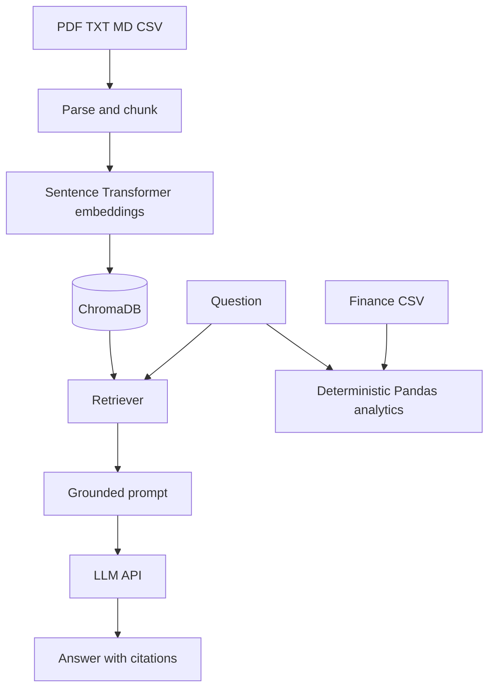

# Finance RAG Assistant

Project: document Q&A using Retrieval-Augmented Generation (RAG), plus deterministic financial analytics. All data is synthetic.

## Features
- Ingest PDF, TXT, Markdown and CSV files.
- Chunk documents, create local embeddings and store them in ChromaDB.
- Retrieve relevant passages and answer with an LLM API when configured.
- Show source filenames and excerpts.
- Calculate exact revenue and outstanding balances from structured CSV data using Pandas.
- Streamlit UI, FastAPI endpoints, Dockerfile and pytest tests.
- Works in retrieval-only mode without an LLM API key.

## Architecture


## Stack
Python 3.11, Streamlit, FastAPI, LangChain text splitters, ChromaDB, Sentence Transformers (`all-MiniLM-L6-v2`), OpenAI API (optional), Pandas, Pytest.

## Setup
```bash
python -m venv .venv
# macOS/Linux: source .venv/bin/activate
# Windows: .venv\Scripts\Activate.ps1
pip install -r requirements.txt
cp .env.example .env
```
Add `OPENAI_API_KEY` to `.env` for generated answers. Without it, retrieval still works and displays relevant excerpts.

Run UI:
```bash
streamlit run app.py
```
Run API:
```bash
uvicorn api:app --reload
```
API docs: http://127.0.0.1:8000/docs

Tests:
```bash
pytest -q
```

## Some Questions We can ask 
- What is the invoice dispute process?
- How long are standard payment terms?
- What is the customer disconnection policy?
- What was total revenue in November 2025?
- Which customer has the highest outstanding balance?

## Design notes
RAG does not train or update LLM weights. It retrieves relevant document chunks at question time. Exact numeric calculations are handled by Pandas, not semantic vector search. Retrieved documents are treated as untrusted context. For production, add authentication, tenant isolation, encryption, rate limiting, monitoring, and stronger evaluation.
